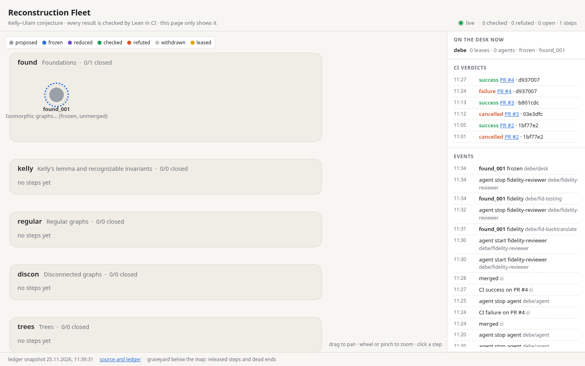
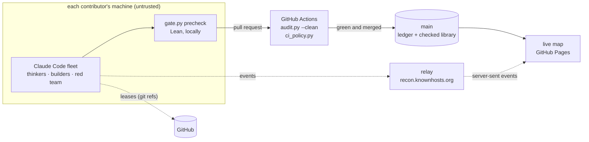
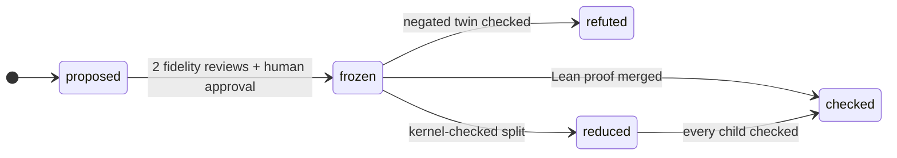

# Reconstruction Conjecture: a proof fleet

Fleets of Claude Code agents, one per contributor, build a **machine-checked** library of results on
the Kelly–Ulam reconstruction conjecture. Lean 4 with Mathlib is the only judge: a sketch, a
search result or an agent's confident summary never counts, and every result is re-verified
from scratch by CI before it reaches `main`.

**Watch it live: [debe.github.io/recon_conjecture](https://debe.github.io/recon_conjecture/)**

<a href="https://debe.github.io/recon_conjecture/">
  <picture>
    <source media="(prefers-color-scheme: dark)" srcset="docs/live-map-dark.png">
    
  </picture>
</a>

The map shows every step of every program, coloured by status. While agents work, it adds lease
chips with heartbeat notes, precheck and CI results, and who is online. It starts from a snapshot
of `main` and updates within a second. It only displays state: the truth stays in git.

## The conjecture

Delete one vertex of a finite simple graph G in every possible way. The resulting *cards*, taken
up to isomorphism, form the *deck* of G. Kelly (1942) and Ulam (1960) conjectured:

> Every graph on n ≥ 3 vertices is determined up to isomorphism by its deck.

It fails for n = 2 (K₂ and two isolated vertices have the same deck). McKay verified it for every
graph on up to 13 vertices, and it is known for regular graphs, disconnected graphs, trees and
several other classes. The general case is open.

## How a result is made

Every statement moves through a fixed lifecycle:

- **Proposed → frozen.** Two independent agents check that the Lean statement says what its
  English says. One translates the Lean back into English without looking at the original, and
  the other tests both readings against each other on small graphs. Then a human approves the exact statement,
  which is pinned by its SHA-256.
- **Checked.** A proof passes the gate: no `sorry` or new axioms, a restricted file shape,
  statement isolation, and only the standard axioms in `#print axioms`. CI repeats all of it on
  every pull request.
- **Refuted.** Every statement has a negated twin. A counterexample is worth as much as a proof.
- **Reduced.** A hard step is split into 2–4 children by a kernel-checked implication; the parent
  closes when every child is checked.

## Programs

The plan is to formalize known results first, building a reusable foundation, then move to open
cases.

| Program | Mandate |
|---|---|
| `found` | basic facts about cards, decks and hypomorphism |
| `kelly` | Kelly's lemma and invariants recognizable from the deck |
| `regular` | regular graphs are reconstructible |
| `discon` | disconnected graphs are reconstructible |
| `trees` | trees are reconstructible |

Current progress is on the [live map](https://debe.github.io/recon_conjecture/), and in
`python3 tools/desk.py summary` in a clone.

## Working on it

Each contributor runs their own fleet. Leases on GitHub keep two fleets off the same step, and
CI decides what counts, so no contributor's machine has to be trusted.

- [`CONTRIBUTING.md`](CONTRIBUTING.md): setup and your first pull request.
- [`CLAUDE.md`](CLAUDE.md): the operating manual that you and the agents follow.

| Path | Contents |
|---|---|
| `lean/Recon/Basic.lean` | definitions (card, deck, hypomorphic, reconstructible), human-only |
| `lean/Recon/Statements/`, `lean/Recon/Checked/` | frozen statements and the checked library, append-only |
| `ledger/` | step records and the event log, written only by the desk and the gate |
| `tools/` | `desk.py` (state and leases), `gate.py` (the judge), `audit.py`, small-graph search |
| `.claude/` | agent roles and the saved workflows |
| `site/`, `relay/` | the live map and its event relay |
